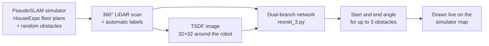

# Learning Obstacle Detection from 2D LiDAR

A neural network that finds obstacles in a robot's 360° LiDAR scan and predicts where each one starts and ends, trained entirely on simulated data. I built it during the BU RISE program in summer 2025 in the Boston University Robotics Lab, advised by Prof. Roberto Tron.

The simulator is [PseudoSLAM](https://github.com/TeaganLi/HouseExpo) by Tingguang Li et al., which I extended for this project (see [Credits](#credits)).

## Results

| Evaluated on | Obstacle-detection accuracy |
|---|---|
| Training environments | 95.5% |
| Unseen maps | 78.7% |

I presented these results as a first-author poster at the BU RISE Symposium. Generalizing to unseen maps is the main open problem.

## How it works



1. **Simulation.** PseudoSLAM loads a 2D floor plan from the HouseExpo dataset and places up to three random obstacles. I added a 360-reading scan (one per degree), functions that compute each obstacle's angular span and distance from the robot, robot respawning, and plotting of scans and model predictions on the map.
2. **Automatic labeling.** For each scan, the simulator's ground truth marks which of the 360 angles hit an obstacle, so data collection needs no hand labeling. The robot is driven through random poses to record labeled scans.
3. **TSDF.** Each scan is also converted into a truncated signed distance field: a small 2D image (32×32) of the distance to the nearest obstacle around the robot.
4. **Model.** The network in [`resnet_3.py`](pseudoslam/envs/resnet_3.py) has two branches:
    - a LiDAR branch with three 1D residual blocks followed by 8-head self-attention over the 360 angles
    - a TSDF branch with three 2D convolution layers, pooled to one feature vector per angle

    The two are concatenated and fused. Then, for each of up to three obstacle slots, separate heads predict the start angle, the end angle and a confidence score.
5. **Training.** AdamW (learning rate 1e-4, weight decay 1e-3), a reduce-on-plateau learning rate schedule, batch size 64, 150 epochs.
6. **Live predictions.** The trained model runs inside the simulator, and its predicted obstacle spans are drawn on the map.

## Repository layout

```
pseudoslam/envs/
├── keyboard_exploration_obs.py   Simulator demo: data collection and live model predictions
├── resnet_3.py                   Final model, dataset and training loop
├── model_testing.py              Evaluation and debugging helpers
├── simulator/                    PseudoSLAM simulator (with my extensions in pseudoSlam.py)
├── config/                       Simulator settings (3-obstacle and 1-obstacle variants)
├── data_tools/                   Scripts to clean, trim, split and inspect the collected data
├── archive/                      Earlier model variants and scratch tests (see archive/README.md)
└── keyboard_exploration.py, keyboard_navigation.py, robot_exploration_v0.py
                                  Original PseudoSLAM demos
HouseExpo/                        10 sample floor plans (full dataset: see Credits)
experiments/                      Original HouseExpo benchmark configs
checkpoints/                      An earlier model checkpoint
```

## Getting started

Developed with Python 3.11 and 3.12. The keyboard demos read raw terminal input, so they run on macOS and Linux.

```bash
git clone https://github.com/elizabethchung/pseudoslam.git
cd pseudoslam
pip install -r requirements.txt
pip install -e .
```

Try the simulator with the original PseudoSLAM demo (`w` forward, `a`/`d` rotate, `q` quit):

```bash
python pseudoslam/envs/keyboard_exploration.py
```

### Full pipeline

The generated dataset and trained weights go in `pseudoslam/envs/data/`. They are not in the repository because of their size.

1. **Collect data:** run `python pseudoslam/envs/keyboard_exploration_obs.py`.
    - `l` and `j` drive the robot through random poses and save the scans and labels.
    - `t` saves the current scan.
    - `e` prints the current scan with its automatic labels.
2. **Train:** `python pseudoslam/envs/resnet_3.py` trains the model, evaluates it on the test set and saves `data/resnet_3.pth`.
3. **Predict:** in `keyboard_exploration_obs.py`, press `m` to run the model on the current scan and draw its predictions on the map.

**Known issue:** `keyboard_exploration_obs.py` and `resnet_3.py` load the dataset and model weights when they start, so on a fresh clone step 1 fails until those files exist. Loading them only when they are needed is the next fix.

## Credits

The simulator and floor plans come from HouseExpo and PseudoSLAM by Tingguang Li, Danny Ho, Chenming Li, Delong Zhu, Chaoqun Wang and Max Q.-H. Meng (The Chinese University of Hong Kong), released under the MIT License, which this repository keeps. The full set of 35,126 floor plans is in `HouseExpo/json.tar.gz` in the [original repository](https://github.com/TeaganLi/HouseExpo).

```bibtex
@article{li2019houseexpo,
  title={HouseExpo: A Large-scale 2D Indoor Layout Dataset for Learning-based Algorithms on Mobile Robots},
  author={Li, Tingguang and Ho, Danny and Li, Chenming and Zhu, Delong and Wang, Chaoqun and Meng, Max Q.-H.},
  journal={arXiv preprint arXiv:1903.09845},
  year={2019}
}
```
